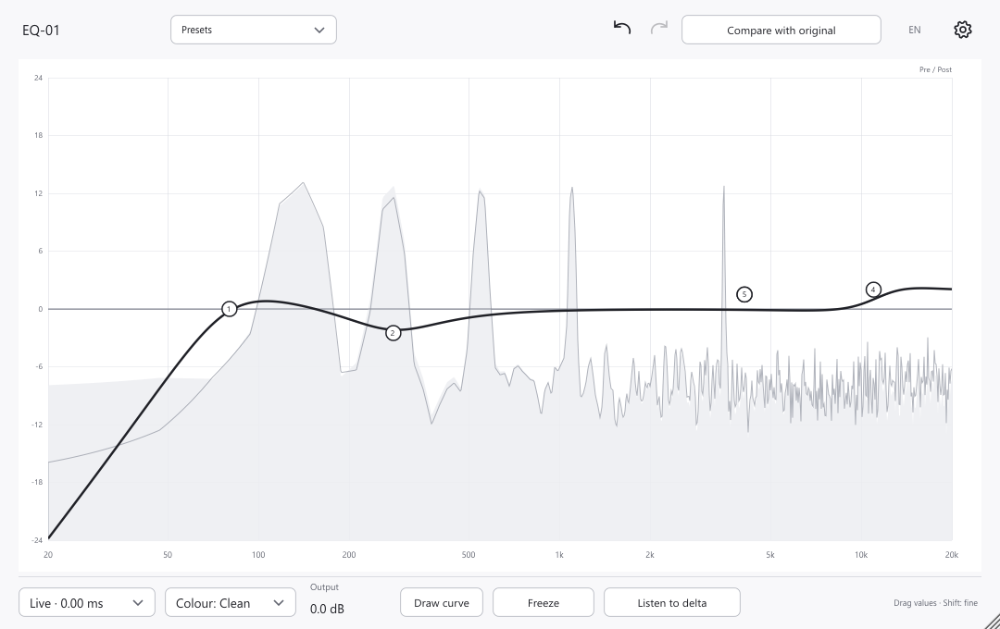

# EQ-01

[English](README.md) · [Скачать VST3](https://github.com/alexeyPetrushin/EQ-01/releases) · [Руководство](docs/USER_GUIDE.ru.md)

[Поддержать автора](https://www.donationalerts.com/r/lesha_diabet_)

EQ-01 — динамический эквалайзер с 24 бэндами, обработкой резонансов и управлением прямо на графике. Перемещай точку, чтобы изменить звук; двойной клик открывает подробные параметры. Интерфейс переключается между русским и английским.

**Скачать готовый плагин:** [Windows x64](https://github.com/alexeyPetrushin/EQ-01/releases/download/v0.3.3/EQ-01-0.3.3-win-vst3.zip) · [macOS Intel / Apple Silicon](https://github.com/alexeyPetrushin/EQ-01/releases/download/v0.3.3/EQ-01-0.3.3-mac-vst3.zip).

**Code → Download ZIP** и архивы **Source code** содержат исходники для разработчиков. Готового плагина в них нет. Для установки скачай файл по ссылке выше или выбери архив с `win-vst3.zip` / `mac-vst3.zip` в [Releases](https://github.com/alexeyPetrushin/EQ-01/releases).

## Скачать и установить

Скачай `EQ-01-0.3.3-win-vst3.zip` для Windows x64 или `EQ-01-0.3.3-mac-vst3.zip` для macOS Intel и Apple Silicon по ссылкам выше. Распакуй архив: внутри находится полный бандл `EQ-01.vst3`. Отдельного установщика нет — плагин устанавливается копированием бандла в папку VST3.

**Windows:** распакуй архив и скопируй папку `EQ-01.vst3` целиком в `%CommonProgramFiles%\VST3`. Этот путь учитывает диск, на котором установлена Windows. Копирование может потребовать права администратора. Если DAW поддерживает пользовательские папки VST3, можно использовать `%LOCALAPPDATA%\Programs\Common\VST3`; другой вариант — собственная папка VST3 в настройках DAW. Пересканируй плагины и добавь **Shaper Audio / EQ-01** на аудиодорожку.

**macOS:** распакуй архив для Mac и скопируй весь бандл `EQ-01.vst3` в `~/Library/Audio/Plug-Ins/VST3` для своего пользователя или `/Library/Audio/Plug-Ins/VST3` для всех. Пересканируй плагины. Универсальная сборка поддерживает macOS 11 и новее, Intel и Apple Silicon. Подпись ad-hoc, нотарификации Apple нет; система может потребовать разрешение в разделе «Конфиденциальность и безопасность».

В Ableton Live включи VST3 в настройках плагинов и сделай Rescan. Для других DAW нужны поддержка VST3 и подходящая архитектура. Обновляй плагин при закрытой DAW. EQ-01 сохраняет VST3-идентификатор предыдущих сборок эквалайзера для совместимости с проектами; устанавливай только одну версию этого плагина.

## Возможности

- 24 бэнда: колокол, полки, срезы, режектор, полосовой, фазовый фильтр и наклон. Срезы 12–96 dB/oct.
- Stereo, Left, Right, Mid и Side для каждого бэнда.
- Динамический EQ: диапазоны выше/ниже порога, колено, соотношение, атака, возврат и относительный детектор.
- Независимая частота/Q детектора, внешний моно/стерео сайдчейн и прослушивание детектора.
- Обработка резонансов банком фильтров или дополнительным движком STFT.
- Спектр до/после обработки, контекстный спектр сайдчейна, стоп спектра, прослушивание бэнда и разницы.
- Пресеты, автоматизация, отмена/повтор, A/B, копирование бэндов, рисование EQ и копирование между экземплярами в одном процессе.
- Дополнительная окраска с передискретизацией 2×; интерфейс EN/RU.

## Задержка и статус

Версия 0.3.3 — рабочая альфа. **Чистый + Живой добавляет 0 отсчётов буферной задержки**, включая динамику и обработку резонансов. Фильтры меняют фазу, детектору требуется время реакции. Движок «Спектр» добавляет **2048 отсчётов** — 42,67 мс при 48 кГц; обычные фильтры EQ остаются минимально-фазовыми. Окраска добавляет небольшую задержку передискретизации. Меняй движок и окраску при остановленном воспроизведении, чтобы DAW обновила компенсацию.

Проверки охватывают загрузку VST3, автоматизацию и состояние, моно/стерео, сайдчейн, создание редактора, задержку и обработку сигнала. Сравнение звучания и проверка полноценных DAW-проектов ещё предстоят. EQ Match, обычная линейная фаза, автоматическая компенсация громкости, анализ маскировки и удалённое редактирование экземпляров пока отсутствуют. Выходного лимитера нет.

[Руководство](docs/USER_GUIDE.ru.md) · [Проверки](docs/VALIDATION.md) · [Сборка](docs/BUILD.md). В архиве для установки находится плагин; исходники и инструменты разработки доступны в репозитории.

## Лицензия

GPL-3.0-or-later: [LICENSE.txt](LICENSE.txt), [сторонние компоненты](ThirdParty/README.md). Используется JUCE 7.0.12 с зафиксированным коммитом и патчами совместимости из `Build/`.
